# Spectado Embed Games

Seven small sports mini-games (football, hockey, basketball) that you can add to an existing iOS, Android or
Expo / React Native app. The games are native code: Swift on iOS, Kotlin on Android. Everything is drawn
with vectors, so the library has no image or sound assets and no third-party runtime dependencies (on
Android it needs only `androidx.activity`). You can theme the games with your club colours, team name and
logo. The text is in Czech, Slovak and English. A game opens full screen or inside your own layout, and it
gives your app a result object when it ends.

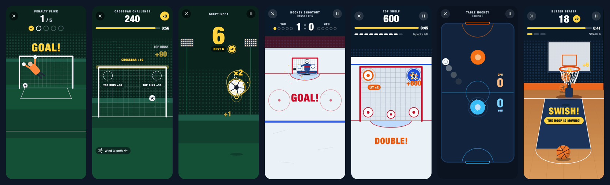

This repository holds the prebuilt binaries: an XCFramework for Swift Package Manager, an AAR in a Maven
repository, and an Expo package on every [GitHub Release](https://github.com/SPECTADO/spectado-embed-games-dist/releases).
You do not need an account or a token to install it. In the snippets below, replace `X.Y.Z` with the latest
version from the Releases page.

**Contents:** [Requirements](#requirements) · [Integration step by step](#integration-step-by-step)
([Expo](#a-expo--react-native) · [Swift](#b-swift-ios) · [Kotlin](#c-kotlin-android)) · [The games](#the-games) ·
[Customization](#customization) · [Result object](#result-object) · [Lifecycle and behaviour](#lifecycle-and-behaviour) ·
[Versioning](#versioning) · [Licence](#licence)

## Requirements

| Platform | Minimum |
|---|---|
| iOS (Swift Package Manager) | iOS 15.1. The framework covers device arm64 and the arm64 and x86_64 simulators. Xcode 27.1 (Swift 6.4) or newer: this release was built with that version, and an older Xcode may not be able to load the framework. |
| Android (Gradle) | minSdk 24, compileSdk 35. The library has been tested with AGP 8.13 and Kotlin 2.0.21. It does not need Compose or AppCompat. |
| Expo / React Native | Expo SDK 53 or newer, in a development build or an EAS build. Expo Go is **not** supported because the library contains native code. The library has been built and run on SDK 58. The iOS deployment target follows your Expo SDK, for example iOS 16.4 on SDK 58. iOS builds need the Xcode version named in the first row. |

Each game is portrait. The full-screen game screens are locked to portrait.

## Integration step by step

### (a) Expo / React Native

1. **Install the package.** It is the npm tarball attached to the GitHub Release, so no registry or token is needed:

   ```sh
   npm install https://github.com/SPECTADO/spectado-embed-games-dist/releases/download/vX.Y.Z/spectado-embed-games-X.Y.Z.tgz
   ```

   This adds `"@spectado/embed-games": "https://…/spectado-embed-games-X.Y.Z.tgz"` to your `package.json`.
   The tarball contains the compiled JavaScript API with TypeScript types, the prebuilt iOS framework, the
   prebuilt Android AAR, and a thin Expo bridge. Autolinking picks it up. You do not need a config plugin,
   a Podfile change or an extra Gradle repository.

2. **Rebuild the native app.** JavaScript reload is not enough, because the package adds native code:

   ```sh
   npx expo prebuild          # only if you use Continuous Native Generation (no checked-in ios/ android/)
   npx expo run:ios           # or: npx expo run:android
   # or a cloud build:  eas build --profile development
   ```

3. **Open a game full screen.** `openGame` resolves when the game screen closes:

   ```tsx
   import { openGame } from '@spectado/embed-games';

   const result = await openGame({ game: 'penalty-flick', locale: 'cs' });
   ```

4. **Or embed a game in your own layout.** Give the view a size, for example `flex: 1`. Props are flat,
   not nested under `config`:

   ```tsx
   import { SpectadoGameView } from '@spectado/embed-games';

   export function GameScreen({ onDone }: { onDone: () => void }) {
     return (
       <SpectadoGameView
         style={{ flex: 1 }}
         game="keepy-uppy"
         locale="en"
         theme={{ primaryColor: '#0B1F3A', teamName: 'HC Example' }}
         bestScore={41}
         onScoreChange={(score) => console.log('score', score)}
         onGameEnd={(result) => onDone()}   // player tapped "Done" (result.completed === true)
         onClose={(result) => onDone()}     // player tapped X
       />
     );
   }
   ```

   The view restarts the game when `game`, `theme`, `locale`, `bestScore` or `options` change by value. A
   re-render with equal values, including a new inline `theme={{…}}` object, keeps the game running. Set
   `paused={true}` to hold the game paused while your own UI covers it. The player cannot resume it until
   you set `paused` back to `false`.

5. **Handle the result.**

   ```tsx
   import { openGame, isAvailable, SpectadoGamesUnavailableError, type GameResult } from '@spectado/embed-games';

   async function play() {
     if (!isAvailable()) return;              // Expo Go or an old dev client: hide the entry point
     try {
       const result: GameResult = await openGame({ game: 'buzzer-beater', bestScore: 30 });
       if (result.completed) {
         console.log(`score ${result.score}, best ${result.bestScore}, swishes ${result.details.swishes}`);
       } else {
         console.log('closed early after', result.durationMs, 'ms');
       }
     } catch (e) {
       if (e instanceof SpectadoGamesUnavailableError) { /* native module not linked */ }
       else throw e;                          // invalid config, or another openGame() is still on screen
     }
   }
   ```

   The JavaScript API:

   | API | Description |
   |---|---|
   | `openGame(config): Promise<GameResult>` | Opens the game full screen. It resolves when the screen closes: after Done, after X or the Android back button, or when your app dismisses the screen itself (`completed: false`). It rejects if the module is missing, the config is invalid, or another `openGame` game is still open. |
   | `<SpectadoGameView game theme locale bestScore options paused onGameEnd onClose onScoreChange style />` | The embedded game. It also takes the normal `View` props such as `testID`. |
   | `getAvailableGames(locale?): GameInfo[]` | Returns every game with its `id`, `sport` and localised `title`. |
   | `getBestScore(game): number` / `resetBestScore(game)` | Reads or clears the best score stored on the device. |
   | `isAvailable(): boolean` | Returns `false` when the native module is not linked, for example in Expo Go or a dev client that was not rebuilt. |
   | `GAMES`, `GAME_IDS`, `LOCALES`, `isGameId(value)` | Constants and a type guard. |

6. **Troubleshooting**

   - *"the native module is not linked in this build"*, or `isAvailable()` returns `false`: rebuild the
     app (step 2). Expo Go cannot load the library.
   - Android build fails with a missing `expo-module-gradle-plugin`: your Expo SDK is older than 53.
     Upgrade the SDK.
   - `openGame` rejects right after another call: a game opened with `openGame` is still on screen.
     Wait for the promise to settle first.
   - Inside a `ScrollView` or a pager, the game keeps every touch that starts on it, because swipes are the
     game's input. Leave room around the view if the page must still scroll.

### (b) Swift (iOS)

1. **Add the package.** In Xcode, choose File > Add Package Dependencies…, enter
   `https://github.com/SPECTADO/spectado-embed-games-dist.git`, choose "Up to Next Major Version" from
   `X.Y.Z`, and add the product **SpectadoEmbedGames** to your app target. In a `Package.swift`:

   ```swift
   dependencies: [
       .package(url: "https://github.com/SPECTADO/spectado-embed-games-dist.git", from: "X.Y.Z"),
   ],
   targets: [
       .target(name: "MyApp", dependencies: [.product(name: "SpectadoEmbedGames", package: "spectado-embed-games-dist")]),
   ]
   ```

   The package is a binary target: a dynamic `SpectadoEmbedGames.xcframework` that Xcode embeds and signs
   with your app.

2. **Import the module:** `import SpectadoEmbedGames`.

3. **SwiftUI.** Use a full-screen cover:

   ```swift
   import SwiftUI
   import SpectadoEmbedGames

   struct PlayButton: View {
       @State private var playing = false

       var body: some View {
           Button("Play") { playing = true }
               .fullScreenCover(isPresented: $playing) {
                   SpectadoGameScreen(
                       config: GameConfig(
                           game: .penaltyFlick,
                           theme: GameTheme(primaryColor: "#0B1F3A", teamName: "FC Example"),
                           locale: "cs"
                       )
                   ) { result in            // called for "Done" and for X
                       print(result.score, result.completed)
                       playing = false
                   }
               }
       }
   }
   ```

   `SpectadoGameScreen(config:onScoreChange:onFinish:onClose:)` gives you separate callbacks for Done and X.
   The view fills the space it gets and draws under the safe areas, so you can also put it inside your own
   layout.

4. **UIKit, full screen.** The completion runs once, after the game screen has closed:

   ```swift
   import SpectadoEmbedGames

   SpectadoGames.present(from: self, config: GameConfig(game: .hockeyShootout, locale: "en")) { result in
       print(result.score, result.won ?? false, result.completed)
   }
   ```

5. **UIKit, embedded view.** `SpectadoGameView` is a `UIView`:

   ```swift
   let gameView = SpectadoGameView(config: GameConfig(game: .keepyUppy))
   gameView.onScoreChange = { score in print(score) }
   gameView.onFinish = { result in /* "Done" tapped */ }
   gameView.onClose = { result in /* X tapped */ }
   gameView.translatesAutoresizingMaskIntoConstraints = false
   view.addSubview(gameView)
   NSLayoutConstraint.activate([
       gameView.leadingAnchor.constraint(equalTo: view.leadingAnchor),
       gameView.trailingAnchor.constraint(equalTo: view.trailingAnchor),
       gameView.topAnchor.constraint(equalTo: view.topAnchor),
       gameView.bottomAnchor.constraint(equalTo: view.bottomAnchor),
   ])
   ```

   Other members: `load(_:)` starts or replaces the game, `pause()` and `resume()` control the pause,
   `isPausedByHost` holds a pause that only your code can lift, and `currentResult` returns the play so far.
   `SpectadoGameViewController(config:)` is the full-screen controller that `present` uses.

6. **Troubleshooting**

   - Xcode cannot load the module `SpectadoEmbedGames` (for example, "compiled with a newer Swift compiler"):
     your Xcode is older than the one that built the release (Xcode 27.1, see
     [Requirements](#requirements)). Update Xcode.
   - Name clash: the public types have plain names (`GameConfig`, `GameResult`, `GameTheme`, `Sport`).
     If your app has a type with the same name, qualify ours with the module name, for example
     `SpectadoEmbedGames.GameConfig`.

### (c) Kotlin (Android)

1. **Add the Maven repository and the dependency.** The repository is the `maven/` folder of this repo:

   ```kotlin
   // settings.gradle.kts
   dependencyResolutionManagement {
       repositories {
           google()
           mavenCentral()
           maven { url = uri("https://raw.githubusercontent.com/SPECTADO/spectado-embed-games-dist/main/maven") }
       }
   }

   // app/build.gradle.kts
   dependencies {
       implementation("com.spectado:embed-games:X.Y.Z")
   }
   ```

   The AAR is minified and carries its own consumer R8 rules, so your release build needs no keep rules.
   Its manifest declares the game Activity and the `INTERNET` permission, which is used only for
   `logoUrl`. Both are merged into your app automatically.

2. **Launch full screen and get the result back** with the `ActivityResultContract`:

   ```kotlin
   import androidx.activity.ComponentActivity
   import com.spectado.games.SpectadoGameContract
   import com.spectado.games.core.GameConfig
   import com.spectado.games.core.GameTheme
   import com.spectado.games.core.SpectadoGame

   class MainActivity : ComponentActivity() {
       private val playGame = registerForActivityResult(SpectadoGameContract()) { result ->
           // GameResult? - null if the system removed the game Activity without a result (see below)
           if (result != null && result.completed) println("score ${result.score}")
       }

       fun play() {
           playGame.launch(
               GameConfig(
                   game = SpectadoGame.penaltyFlick,
                   theme = GameTheme(primaryColor = "#0B1F3A", teamName = "FC Example"),
                   locale = "en",
               )
           )
       }
   }
   ```

   The result is `null` when the system removed the game Activity instead of the Activity finishing
   itself: the process was killed, or your app cleared the game from the task, for example with a deep
   link into a `singleTask` Activity below it.

   To launch without a result, call `SpectadoGames.launch(context, config)`. You can pass an optional
   `SpectadoGameView.Listener` for in-process callbacks. The Activity finishes itself after Done, X or back.
   If your app removes the game Activity itself, the listener still gets `onClose` with the play so far.

3. **Embed the View:**

   ```kotlin
   import com.spectado.games.SpectadoGameView

   val gameView = SpectadoGameView(context).apply {
       onScoreChange = { score -> println(score) }
       onFinish = { result -> /* "Done" tapped */ }
       onClose = { result -> /* X tapped */ }
       load(GameConfig(game = SpectadoGame.keepyUppy))
   }
   container.addView(gameView, ViewGroup.LayoutParams(MATCH_PARENT, MATCH_PARENT))
   ```

   The view also offers `pause()`, `resume()`, `isPausedByHost` and `currentResult`. Java hosts use
   `setListener(SpectadoGameView.Listener)` instead of the lambdas. The view calls
   `requestDisallowInterceptTouchEvent`, so a parent `ScrollView` or `ViewPager` does not take the game's swipes.

4. **Jetpack Compose** (the library itself has no Compose dependency). Embedded:

   ```kotlin
   import androidx.compose.foundation.layout.fillMaxSize
   import androidx.compose.runtime.Composable
   import androidx.compose.ui.Modifier
   import androidx.compose.ui.viewinterop.AndroidView
   import com.spectado.games.SpectadoGameView
   import com.spectado.games.core.GameConfig
   import com.spectado.games.core.GameResult

   @Composable
   fun Game(config: GameConfig, onDone: (GameResult) -> Unit) {
       AndroidView(
           modifier = Modifier.fillMaxSize(),
           factory = { ctx ->
               SpectadoGameView(ctx).apply {
                   onFinish = onDone
                   onClose = onDone
                   load(config)
               }
           },
       )
   }
   ```

   Full screen from Compose (needs `androidx.activity:activity-compose`):

   ```kotlin
   val launcher = rememberLauncherForActivityResult(SpectadoGameContract()) { result -> /* GameResult? */ }
   Button(onClick = { launcher.launch(GameConfig(game = SpectadoGame.tableHockey)) }) { Text("Play") }
   ```

5. **Troubleshooting**

   - *"Could not find com.spectado:embed-games"*: Gradle cannot see the Maven repository. With
     `dependencyResolutionManagement`, repositories in module `build.gradle(.kts)` files are ignored, so add
     the repository in `settings.gradle(.kts)`.

## The games

All seven games share the same frame. A ready screen shows a hint until the player makes the first move,
and that move starts the game: the first shot, the first tap on the ball, or the first drag. A touch that
is not a valid move, for example a tap next to the ball in Keepy-Uppy, leaves the ready screen showing. The
close (X) button is always available, and most games also have a pause button. When a game ends, a result screen shows the score, the best score, **Play again** and **Done**.

### Penalty Flick · `penalty-flick` · football

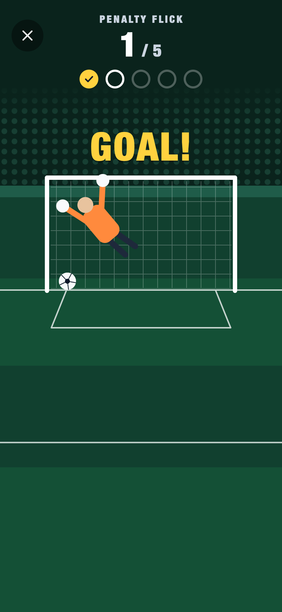

You take a penalty shootout against a goalkeeper who reads your shots a little better each round.

- **Controls:** swipe up to shoot. Curve the swipe to bend the ball.
- **Scoring:** each goal is 1 point, so the score is 0–5.
- **Length:** 5 shots, about half a minute.
- **Options:** none. There is no pause button.
- **`details`:** `goals`, `shots`, `saved`, `missed`

<br clear="right">

### Crossbar Challenge · `crossbar-challenge` · football

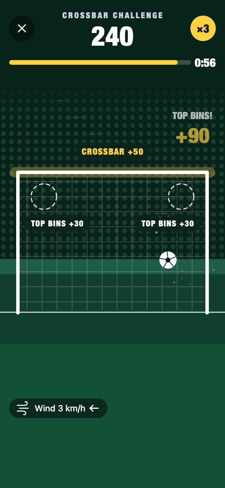

You shoot from distance and try to hit the woodwork and the top corners. A wind that changes every few
shots pushes the ball sideways.

- **Controls:** swipe up to shoot. The swipe's direction and length set where the ball goes, and the wind
  pushes it sideways.
- **Scoring:** crossbar or post +50, top bins +30. Consecutive woodwork hits build a multiplier up to ×5,
  and a miss resets it. A plain goal scores +10.
- **Length:** 60 seconds.
- **Options:** none. There is no pause button.
- **`details`:** `shots`, `crossbars`, `posts`, `topBins`, `goals`, `missed`, `bestCombo`

<br clear="right">

### Keepy-Uppy · `keepy-uppy` · football

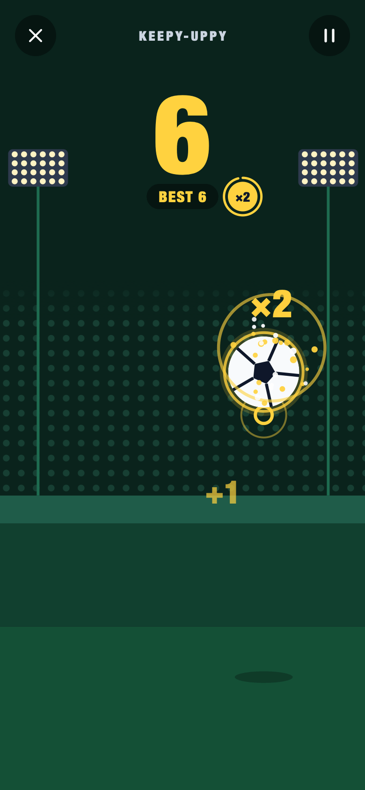

You keep the ball in the air for as long as you can. The ball bounces off the side walls. Gravity keeps
growing, so every run ends.

- **Controls:** tap the ball while it is coming down. Tap off-centre to steer it. A tap on the sweet spot
  gives a perfect bounce.
- **Scoring:** +1 per kick. After you catch a gold ball, kicks count double for 5 seconds.
- **Length:** until the ball touches the grass.
- **Options:** none.
- **`details`:** `kicks`, `perfects`, `goldBalls`, `wallHits`

<br clear="right">

### Hockey Shootout · `hockey-shootout` · hockey

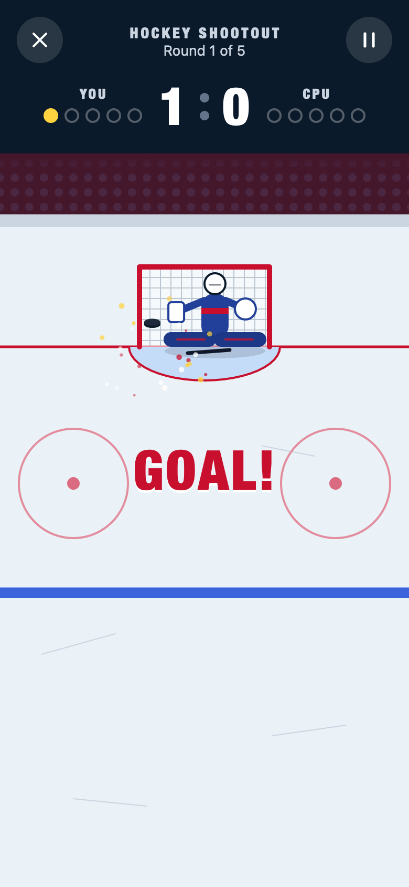

You play a shootout against the CPU. You take turns: you shoot, then you are the goalie for the CPU's shot.

- **Controls:** to shoot, pull back from the puck and release. The pull length sets the power and the angle
  sets the side. Drag sideways to deke. As the goalie, drag left or right to move.
- **Scoring:** the score is your goals. `won` is `true` when you score more goals than the CPU.
- **Length:** 5 rounds, then sudden death if the score is tied.
- **Options:** none.
- **`details`:** `goals`, `conceded`, `shots`, `cpuShots`, `saves`, `dekes`, `rounds`, `suddenDeath` (0/1)

<br clear="right">

### Top Shelf · `top-shelf` · hockey

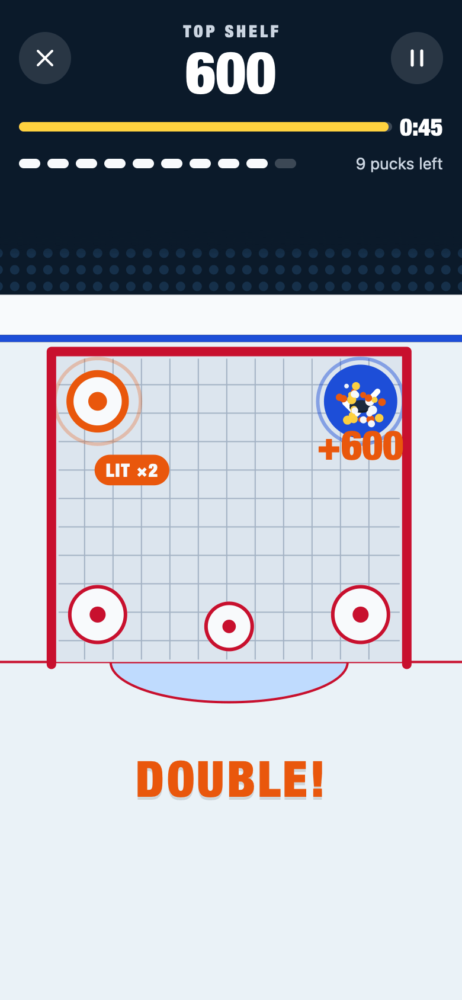

You shoot pucks at five round targets in the net. One target is lit, and the lit target scores double.

- **Controls:** flick the puck towards the net.
- **Scoring:** a target is worth 200–300 points, and the lit target is worth ×2. Clearing all five targets
  adds +1,000, and then the targets come back. A goal that misses every target scores +50.
- **Length:** 10 pucks or 45 seconds, whichever runs out first.
- **Options:** none.
- **`details`:** `shots`, `targets`, `lit`, `clears`, `goals`, `posts`, `missed`, `timeLeft` (seconds), `timeUp` (0/1)

<br clear="right">

### Table Hockey · `table-hockey` · hockey

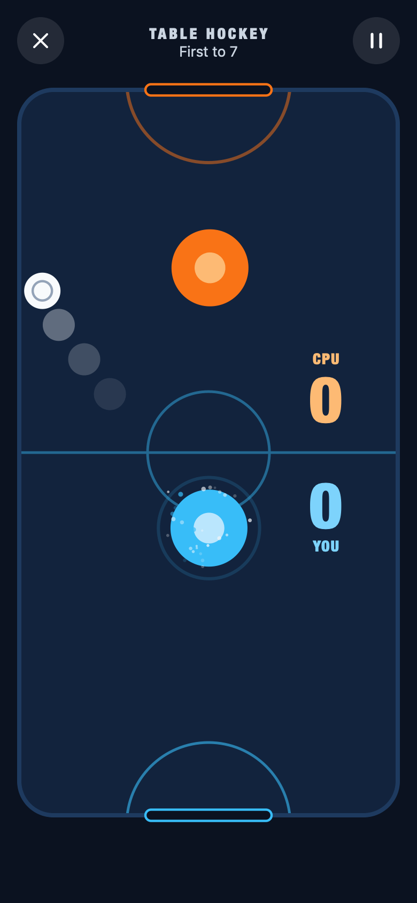

An air hockey duel on a neon table, against the CPU or against a friend on the same phone.

- **Controls:** drag your paddle in your half. In two-player mode, each player uses one finger in their
  own half (multi-touch).
- **Scoring:** the score is your goals (player 1's goals in two-player mode). `won` is `true` when you win.
- **Length:** the first player to 7 goals wins.
- **Options:** `mode`: `cpu` (default) or `twoPlayers`. `difficulty`: `easy`, `normal` (default) or `hard`,
  for CPU mode.
- **`details`:** `goals`, `conceded`, `hits`, `fastestShot`, `twoPlayers` (0/1), `difficulty` (0 = easy,
  1 = normal, 2 = hard). `fastestShot` is the hardest hit of your paddle, in logical units per second. The
  screen is 390 units wide.

<br clear="right">

### Buzzer Beater · `buzzer-beater` · basketball

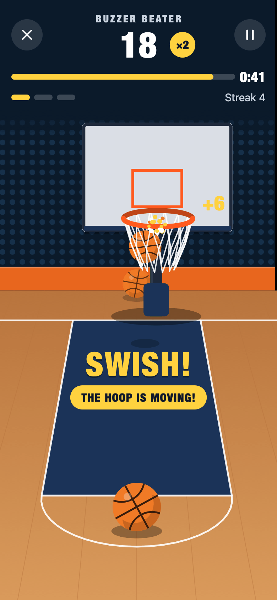

You shoot as many baskets as you can before the buzzer. After a few makes, the hoop starts to move.

- **Controls:** swipe up to shoot. The swipe's direction aims the shot, and its length and speed set the power.
- **Scoring:** a swish is +3 and any other make is +2. Every 3 makes in a row raise the multiplier, up to ×4.
- **Length:** 45 seconds.
- **Options:** none.
- **`details`:** `makes`, `shots`, `swishes`, `bestStreak`, `accuracy` (0–1), `buzzerBeaters`

<br clear="right">

## Customization

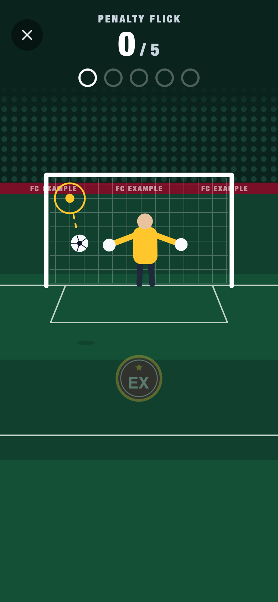
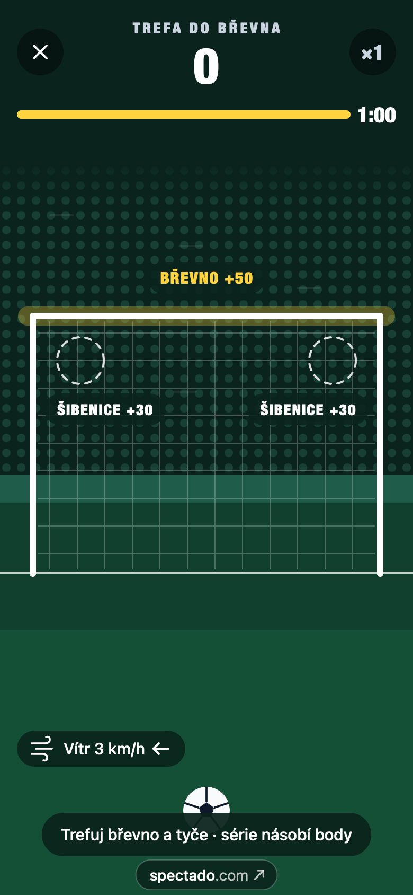
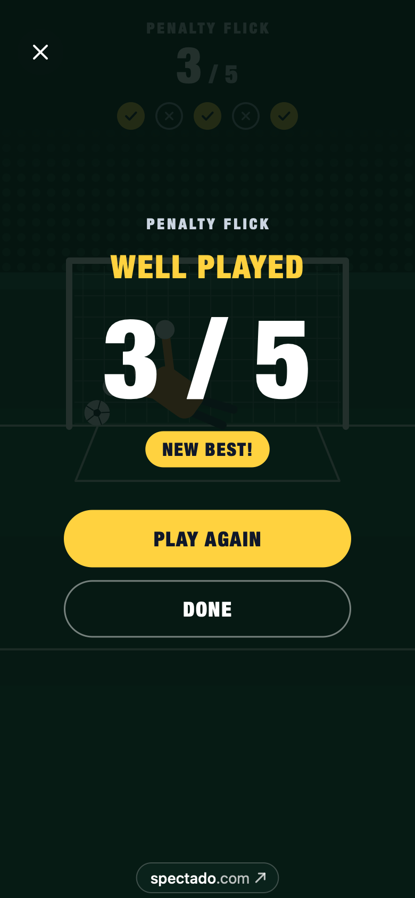

*Left: a team theme with a name and logo. Middle: Czech. Right: the result screen, with the spectado.com link.*

The config is the same on all platforms. Expo `openGame` takes it as an object and `<SpectadoGameView>` takes
it as props. In Swift it is `GameConfig(…)` and in Kotlin `GameConfig(…)`.

| Field | Type | Default | Description |
|---|---|---|---|
| `game` | game id | required | One of the seven ids. In Swift use `.penaltyFlick`; in Kotlin use `SpectadoGame.penaltyFlick`. |
| `theme.primaryColor` | `"#RRGGBB"` | game palette | The club's main colour: jerseys, boards, your side. |
| `theme.secondaryColor` | `"#RRGGBB"` | game palette | The supporting colour: the opponent and secondary surfaces. |
| `theme.accentColor` | `"#RRGGBB"` | game palette | The highlight colour: score popups, targets, the primary button. |
| `theme.teamName` | string | none | Shown on boards and banners where the game has room for it. |
| `theme.logoUrl` | string | none | `https://` or `file://` URL, loaded asynchronously. Android also accepts `content://` and `android.resource://`. |
| `theme.logo` | image | none | A logo that is already loaded, and it wins over `logoUrl`. In Expo use `require('./logo.png')`, in Swift `GameTheme(…, logoImage: UIImage)`, and in Kotlin `theme.withLogo(bitmap)` (`import com.spectado.games.withLogo`). |
| `locale` | `"cs"` \| `"sk"` \| `"en"`, or a region tag | device language | See below. |
| `bestScore` | integer | none | The best score your app knows, for example from your backend. |
| `options` | map of strings | `{}` | Per-game options, see below. Unknown keys are ignored. |

**Colours.** Use `#RRGGBB` only. Expo logs a warning for any other format and uses the default colour.

**Logo.** Use a square PNG with a transparent background, 256–512 px. The logo is clipped to a circle,
so keep the artwork inside the inscribed circle. It is drawn at most about 80 pt wide and often
semi-transparent, for example as a centre-ice or pitch mark, so simple, bold marks work best. Android
downsamples logos larger than 512 px and ignores downloads over 8 MB. Use `https` URLs, because iOS App
Transport Security blocks plain `http`. If the logo fails to load, the game runs without it.

**Locale.** `cs`, `sk` and `en` are supported. Region tags such as `cs-CZ` and `sk_SK` are accepted. If you
leave the locale out or pass an unsupported value, the game uses the first supported language in the
device's preferred languages, then `en`. `getAvailableGames(locale)` (Expo) and `SpectadoGame.title(_:)`
(Swift and Kotlin) return the localised titles.

**Best score.** The library stores the best score per game on the device (UserDefaults or
SharedPreferences). The best score shown in the game and returned in the result is
`max(stored on device, config.bestScore)`. To read or clear it, use `getBestScore` / `resetBestScore`
(Expo), `SpectadoGames.bestScore(for:)` / `resetBestScore(for:)` (Swift), or
`BestScoreStore.best(context, game)` / `BestScoreStore.reset(context, game)` (Kotlin).

**Per-game options:**

| Game | Key | Values (default first) |
|---|---|---|
| `table-hockey` | `mode` | `cpu`, `twoPlayers` |
| `table-hockey` | `difficulty` | `normal`, `easy`, `hard` (CPU mode) |
| all other games | none | none |

**What cannot be customised:** game rules, lengths and scoring, the text and its languages, fonts, the
layout of the HUD and buttons, and portrait orientation. The games have no sound or haptics. Every game
always shows a small **spectado.com** link on its ready, pause and result screens. The link is hidden
during play, so it never takes a gameplay touch. No setting turns it off. Tapping it opens
https://spectado.com in the browser.

## Result object

`openGame`, the `onGameEnd` and `onClose` props, `onFinish` and `onClose` in Swift and Kotlin, and the
Android contract all deliver the same object.

| Field | Expo (TS) | Swift | Kotlin | Description |
|---|---|---|---|---|
| `gameId` | `GameId` | `String` | `String` | The game id, for example `"penalty-flick"`. |
| `score` | `number` | `Int` | `Int` | The final score. Higher is better. |
| `won` | `boolean?` | `Bool?` | `Boolean?` | Set only by the versus games (`hockey-shootout`, `table-hockey`). |
| `durationMs` | `number` | `Int` | `Int` | The time actually played, without pauses. |
| `completed` | `boolean` | `Bool` | `Boolean` | `true` once the game has ended. `false` when the player closed it (X or back) or your app dismissed it before the end. |
| `bestScore` | `number` | `Int` | `Int` | The best score after this play. |
| `details` | `Record<string, number>` | `[String: Double]` | `Map<String, Double>` | Game-specific numbers. The keys are listed under each game. Booleans are `0`/`1`. |

## Lifecycle and behaviour

- **Pause.** Games with a pause button pause when the player taps it, and a tap anywhere resumes.
  `pause()` on the views pauses any running game. `isPausedByHost` (Swift and Kotlin) and the `paused`
  prop (Expo) hold a pause that the player cannot lift. X and the result buttons still work during it.
- **Backgrounding.** When the app goes to the background, a running game pauses. The same happens when
  the embedded view leaves the window, and when the player opens spectado.com. When the player comes
  back, the game shows the pause overlay. The ready and result screens have nothing to pause.
- **Closing early.** X, the Android back button, or your app dismissing the full-screen game ends the
  game with `completed: false` and the play so far. The full-screen APIs report exactly once. One
  exception: the Android `SpectadoGameContract` returns `null` when your app removes the game Activity
  itself, because Android delivers no result then. Use a `Listener` to get the play so far in that case.
  If the player gets a new best score just before closing, it is still stored.
- **Play again.** This restarts the game in place. `onScoreChange` reports `0`. Your app gets a result
  only on Done or close.
- **Orientation and size.** Full-screen games are portrait-only. An embedded view can have any size. The
  scene is 390 logical units wide and 640–1000 units tall, and it is scaled to fit your view. Outside
  that aspect ratio it is centred with black bars, so a portrait area works best. The game draws under
  the safe areas and keeps its HUD and buttons inside them.
- **Rendering.** The game draws with the platform canvas (CoreGraphics on iOS, `android.graphics` on
  Android). The game loop stops while the view is detached or the app is in the background.

## Versioning

The library uses [Semantic Versioning](https://semver.org/). All three channels share one version, and
each release is the git tag `vX.Y.Z` of this repository, with the XCFramework and the Expo tarball
attached to its GitHub Release. Released versions are never changed. Pin an exact version in production
apps. For the history, see [CHANGELOG.md](CHANGELOG.md).

## Licence

MIT, Copyright (c) 2026 SPECTADO. See [LICENSE](LICENSE).
